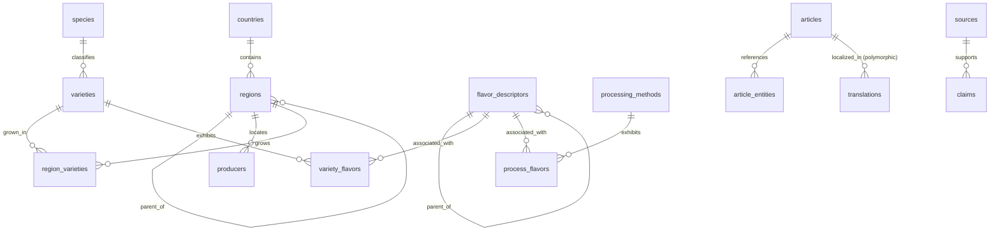

# Coffee Knowledge PostgreSQL Data Model (Debt Closed)

All tables live in the `knowledge` schema, owned exclusively by the `knowledge` module (`UUID` primary keys, server-side `TIMESTAMPTZ`, `semaian_runtime` DML-only).

## 1. Entity-Relationship Diagram

## 2. Core Entities & Editorial Tables (Phase 3.1)
| Table | Purpose | Key Constraints & Indexes |
|---|---|---|
| `knowledge.countries` | ISO country reference | `PK(id)`, `UNIQUE(iso_code)` |
| `knowledge.regions` | Regions & subregions | `PK(id)`, `FK(country_id)`, `FK(parent_id)` nullable, `UNIQUE(country_id, slug)` |
| `knowledge.producers` | Optional farms/coops/stations | `PK(id)`, `FK(region_id)`, `CHECK(producer_type IN ('farm','estate','cooperative','washing_station'))` |
| `knowledge.species` | Botanical species | `PK(id)`, `UNIQUE(scientific_name)` |
| `knowledge.varieties` | Cultivars & synonyms | `PK(id)`, `FK(species_id)`, `UNIQUE(slug)` |
| `knowledge.processing_methods` | Extensible processes | `PK(id)`, `UNIQUE(slug)` |
| `knowledge.roast_levels` | General roast references | `PK(id)`, `UNIQUE(slug)` |
| `knowledge.flavor_descriptors` | Hierarchical sensory taxonomy | `PK(id)`, `FK(parent_id)` nullable, `UNIQUE(slug)` |
| `knowledge.articles` | Editorial guides & publication state | `PK(id)`, `UNIQUE(slug)`, `CHECK(status IN ('draft','submitted','under_review','approved','published','superseded','archived'))` |
| `knowledge.translations` | Canonical localization for all entities | `PK(id)`, `UNIQUE(entity_type, entity_id, locale)`, `CHECK(locale IN ('id','en'))`, `CHECK(status IN ('draft','published','archived'))`, `GIN` FTS index |
| `knowledge.sources` | External/original source registry | `PK(id)`, `CHECK(license_type IN ('original','public_domain','cc0','cc_by','permissive','restricted'))` |
| `knowledge.claims` | Factual claim ↔ source evidence | `PK(id)`, `FK(source_id)`, `CHECK(verification_status IN ('draft','pending_review','verified','rejected','archived'))` |
| `knowledge.revisions` | Immutable revision & review log | `PK(id)`, `target_type`, `target_id`, `actor_id` (UUID, no cross-schema FK) |

## 3. Relationship / Join Tables (Phase 3.1)
| Table | Source → Target (Cardinality) | PK, Unique & FK Constraints | Optionality & Lifecycle |
|---|---|---|---|
| `knowledge.region_varieties` | `regions` ↔ `varieties` (M:N) | `PK(id)`, `UNIQUE(region_id, variety_id)`, `FK(region_id)`, `FK(variety_id)`, `FK(source_claim_id)` nullable | Optional; archived with parent |
| `knowledge.variety_flavors` | `varieties` ↔ `flavor_descriptors` (M:N) | `PK(id)`, `UNIQUE(variety_id, flavor_descriptor_id)`, `FK(variety_id)`, `FK(flavor_descriptor_id)`, `FK(source_claim_id)` nullable | Optional; carries `confidence` (`high`,`medium`,`exploratory`) |
| `knowledge.process_flavors` | `processing_methods` ↔ `flavor_descriptors` (M:N) | `PK(id)`, `UNIQUE(processing_method_id, flavor_descriptor_id)`, `FK(processing_method_id)`, `FK(flavor_descriptor_id)`, `FK(source_claim_id)` nullable | Optional; carries `confidence` |
| `knowledge.article_entities` | `articles` → structured entity (M:N) | `PK(id)`, `UNIQUE(article_id, entity_type, entity_id)`, `FK(article_id)` | Optional; deleted if draft article is removed |

## 4. Archival vs. Soft Deletion
- Published knowledge is **never hard-deleted**; it transitions to `superseded` or `archived` to preserve citation integrity.
