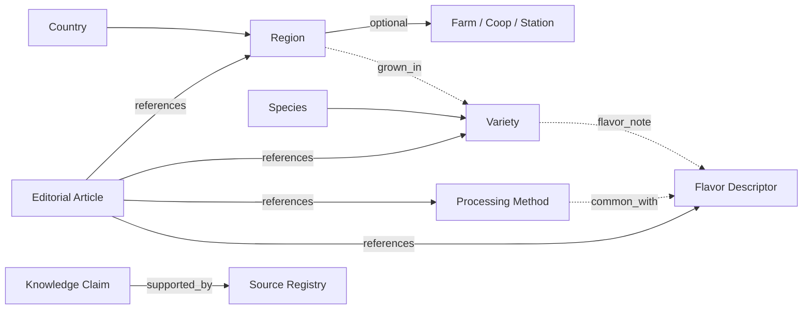

# Coffee Knowledge Graph & Relationships

## 1. Conceptual Relationship Model
Semaian uses a **relational PostgreSQL model with explicit relationship tables** (no graph database; no circular module dependencies).

## 2. Relationship Rules
- **Cardinality**: Many-to-many associations (e.g., `variety_flavors`, `region_varieties`, `article_entities`) use explicit join tables with `confidence` (`high`, `medium`, `exploratory`) and optional `source_claim_id`.
- **Optionality**: All origin-to-farm, variety-to-flavor, and article-to-entity links are **optional** to support incomplete real-world coffee data.
- **No Cross-Module FKs**: `knowledge` never holds foreign keys to `organization` or `brew` tables.
